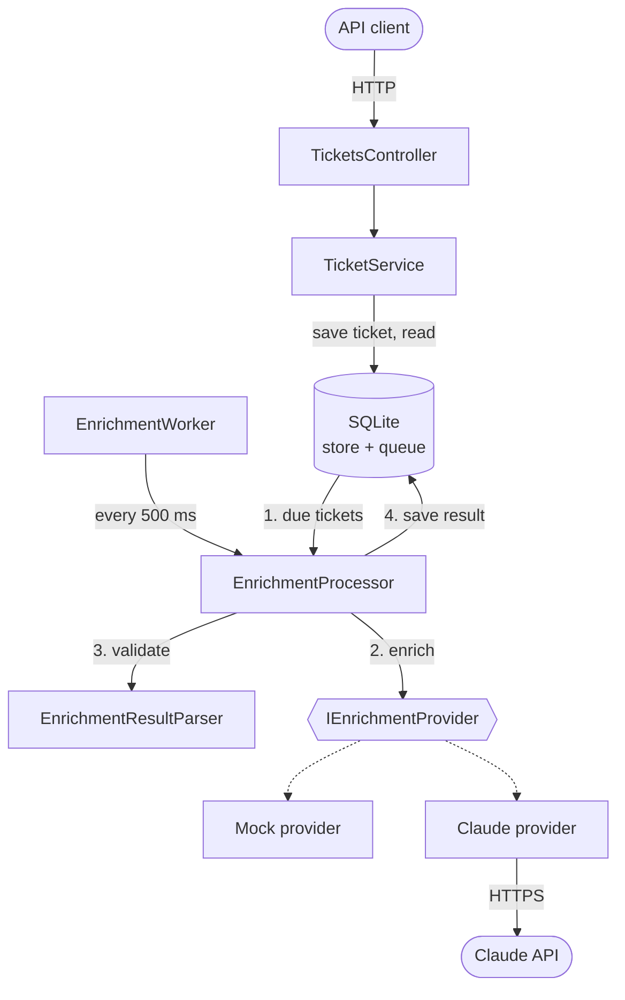

# Design

## Components

The request path (client to database) and the enrichment path (worker to provider) meet only at
the database, which is both the ticket store and the work queue. Nothing on the request path can
reach the AI provider. Step 4 saves either the enrichment result or the failed attempt. The mock
provider is the default; the Claude provider is opt-in.
## API

| Request | Response |
|---|---|
| `POST /api/v1/tickets` with `{ id, subject, message }` (`id` is exactly 6 digits) | `202` + `Location` for a new ticket. `200` if the same id and content was already submitted. `409` if the id exists with different content. `400` for invalid input. |
| `GET /api/v1/tickets/{id}` | `200` with the ticket and `enrichment { status, category, priority, summary, attempts, enrichedAt }`. `404` if unknown. |

The full contract is in [docs/openapi.json](docs/openapi.json).

- **Intake is asynchronous.** `POST` only stores the ticket and returns `202`; a background worker
  enriches it. The request path never calls the AI provider, so a provider failure cannot fail or
  slow a submission. This is the decision the rest of the design follows from.
- **Clients poll.** `enrichment.status` is `Pending`, `Completed` or `Failed`. A pending ticket is
  a normal `200` with null enrichment fields, not an error.
- **`POST` is idempotent on the ticket id**, so a client that times out can safely resend.
- **Errors are RFC 7807 problem details.** Provider errors are never exposed to clients.
- **The path is versioned** (`/api/v1`) so the contract can change without breaking clients.

## Open questions and assumptions

| Question for product / stakeholders | Assumption made | If the answer is different |
|---|---|---|
| Is "an identifier" the ticket's id or the customer's? | The ticket id, supplied by the client. | Customer id: the server generates the ticket id, `POST` returns `201`, and idempotency moves to an `Idempotency-Key` header. |
| What format do ticket ids have? | A 6-digit number, `000000` to `999999`. Kept as a string, so leading zeros are part of the id. | Other formats (longer numbers, prefixes, UUIDs): change the one validation rule; nothing else depends on it. Six digits also caps the system at one million tickets, so confirm the id space before real volume. |
| Does any client need the enrichment in the submit response? | No; seconds of delay are fine. | Wait for the provider up to a short deadline and fall back to `202`, or push results by webhook. |
| Is the taxonomy fixed, and what about tickets that fit no category? | Fixed: `FeatureRequest`, `Bug`, `Billing`, `Account`; `Low` to `Urgent`. Anything else is invalid output. | A ticket that fits none currently ends `Failed`. Add an `Other` category, or make the taxonomy configuration. |
| What should happen to a ticket the AI never enriches? | It stays stored, marked `Failed`, for a human or a later re-run. | A rules-based fallback, or a triage queue with alerting. |
| What volume and enrichment latency are expected? | One instance and SQLite are enough to show the design. | See "Before production": a server database, several workers, a concurrency limit per provider. |
| Can a ticket be edited or resubmitted with changes? | No; tickets are immutable. | Add `PUT`, and re-enrich when content changes. |
| May ticket text be sent to a third-party LLM? Retention rules? | Yes, and no retention policy. Logs never contain ticket text. | PII redaction before the call, a regional or self-hosted model, deletion endpoints. |
| Who may call the API? One tenant or many? | No authentication, single tenant. | Auth at the gateway or in the service; tenant id on every row and query. |
| Does priority drive SLAs or paging? | No; it is advisory. | Wrong answers become costly: add a confidence score and human review for `Urgent`. |
| Is there a cost budget per ticket? | At most 5 attempts per ticket. | Token limits, a cheaper model first, a daily spend cap. |

## Architecture decisions and trade-offs

- **The database is the queue.** Each ticket row carries its status, attempt count and next
  attempt time; the worker polls for due rows every 500 ms. No ticket is lost on a crash or
  restart, and there is no broker to run. The cost is polling load, up to half a second before a
  new ticket is picked up, and a throughput ceiling, all acceptable at this stage. Intake and the
  worker share nothing but the table, so the worker can move to its own process unchanged.
- **At-least-once enrichment.** A crash mid-attempt leaves the ticket pending and it is retried.
  A duplicate provider call is possible; a lost ticket is not.
- **Failures are data, not exceptions.** Timeout, outage, rate limit and invalid output are each
  recorded on the ticket and retried with exponential backoff and jitter. After
  `MaxAttempts` the ticket is `Failed`, which is terminal.
- **A provider failure stops the current batch.** If the provider is down, the remaining tickets
  would fail the same way and use up their attempts. Invalid output is specific to one response,
  so it does not stop the batch. This is a minimal stand-in for a circuit breaker.
- **Model output is untrusted.** `EnrichmentResultParser` accepts only the exact schema; enum
  values are matched by name, since `Enum.TryParse` would also accept `"1"` or `"Bug,Billing"`.
  Validation sits outside the provider, so every provider is held to the same rules.
- **One provider seam.** `IEnrichmentProvider` returns raw text and is the only thing an LLM
  client has to implement. The mock and the Claude provider both sit behind it.
- **One project, folders by concern** (`Api`, `Tickets`, `Enrichment`, `Domain`, `Persistence`).
  Splitting into several assemblies would add ceremony without enforcing anything useful yet.
  Services use the EF Core `DbContext` directly; it already is the repository and unit of work.

## Implemented, described only, and left out

**Implemented:** both endpoints, validation, idempotent intake, SQLite persistence, the background
worker, timeout, retry and backoff, strict output validation, the mock provider with five failure
modes, and 57 tests.

**Implemented but not verified against the live API: a Claude provider.**
`ClaudeEnrichmentProvider` uses the official Anthropic C# SDK, reads its key from the
`ANTHROPIC_API_KEY` environment variable, and asks for structured output constrained to the
enrichment schema. It maps `429`, `5xx` and network errors to `EnrichmentProviderException` so
the worker retries them, and turns the SDK's own retries off so the two do not multiply. The
prompt tells the model to treat ticket text as data, because customers can write instructions
into a ticket; the parser remains the last line of defence. It is off by default
(`Enrichment:Provider=Mock`). No API key was available while building this, so it compiles and
fails cleanly without a key, but has not made a real call. The automated tests never use it;
`--claude-smoke-test` (see the README) is the check to run once a key is available.

Known gaps in it: a provider's `Retry-After` is ignored, so a rate-limited ticket is
retried on our own backoff, possibly sooner than the provider asked; using it may affect user experiance 
and we would like to handle it correctly
the model (`claude-haiku-5-5`) was not chosen by evaluation, but its likely enough for classification at a fraction of the cost.

**Left out on purpose:** authentication, rate limiting, listing and search, editing tickets, a
re-enrich endpoint for failed tickets, webhooks.

**Before production:**

- A real circuit breaker, so a long outage pauses the worker instead of failing tickets.
- A server database with migrations (the schema is currently created with `EnsureCreated`).
- Row leasing so several worker instances can run without enriching the same ticket twice.
- Concurrent provider calls with a limit; the worker is sequential today.
- Metrics and alerts: queue depth, enrichment latency, failure rate by cause, count of `Failed`.
- Authentication, rate limiting, PII handling and a retention policy.
- An evaluation set for prompt and model quality, and a container image with CI.

## Next phase across three engineers

The two seams, `IEnrichmentProvider` and the OpenAPI contract, let three people work in parallel
with few conflicts. **Engineer A (AI)** verifies and hardens the Claude provider, tunes the prompt
and model against an evaluation set with accuracy targets, and adds the circuit breaker and cost
tracking. **Engineer B (data and scale)**
moves to a server database with migrations, adds row leasing and concurrent workers, and
load-tests against the expected volume. **Engineer C (API and platform)** adds authentication,
rate limiting, the re-enrich and list endpoints, metrics and alerting, and the CI and deployment
pipeline. Each starts by agreeing the contract change for their area in a short design note, so
integration is not left to the end.
